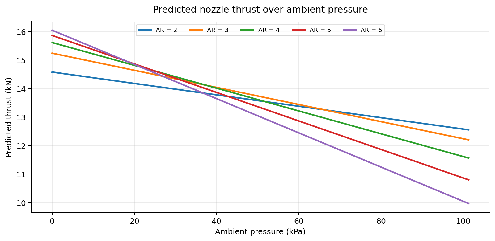
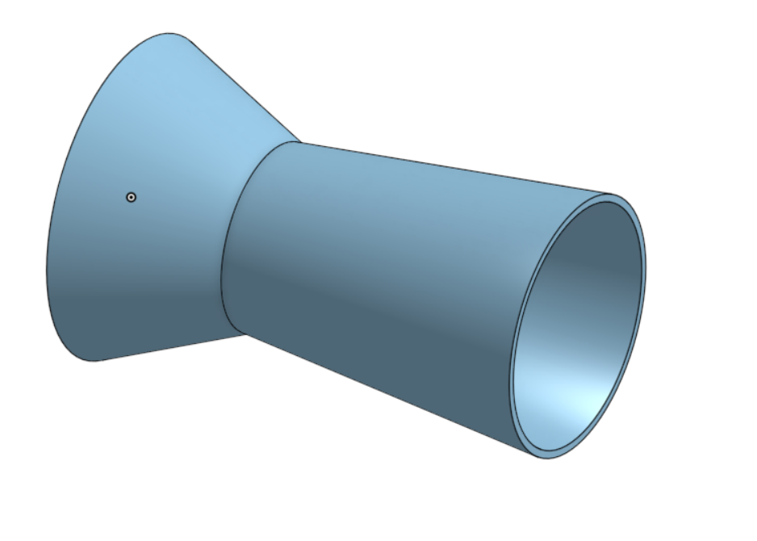
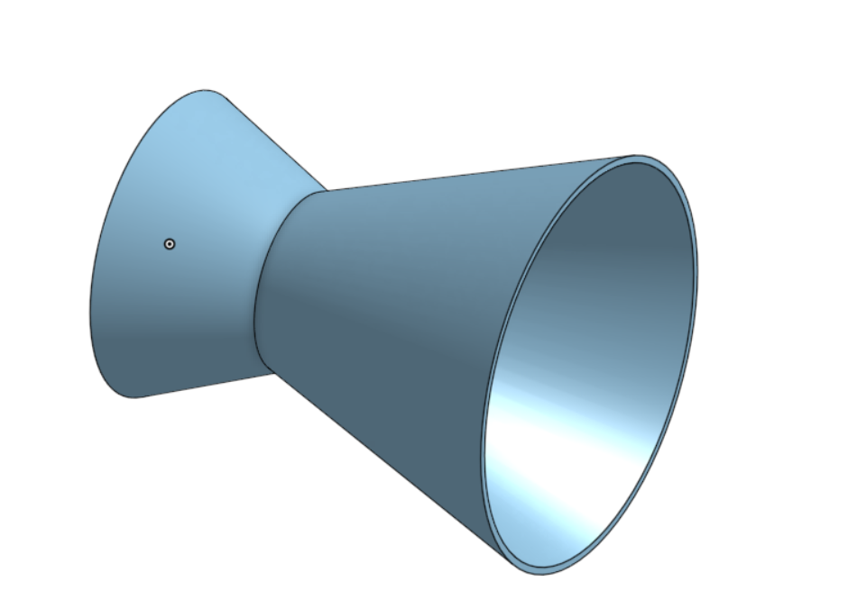

# De Laval Nozzle — Thrust Analysis

A student engineering study exploring how ambient pressure and exit-to-throat area ratio influence the **predicted thrust** of a converging–diverging (De Laval) nozzle. The project combines a one-dimensional isentropic-flow model, Python calculations, and parametric CAD models created in Onshape.

## Research question

How do nozzle area ratio and ambient pressure affect predicted thrust when chamber conditions and throat area are held constant?

## Method

Five area ratios (AR = 2, 3, 4, 5, and 6) were evaluated at 101 ambient-pressure values spanning **101.325 kPa to 0 kPa**. The notebook solves the supersonic area–Mach relation, estimates exit properties, and computes ideal thrust using momentum and pressure terms:

```text
F = m_dot * V_e + (P_e - P_amb) * A_e
```

The numerical work uses Python, NumPy, SciPy, and Matplotlib. The CAD geometries share a fixed throat area and vary exit radius according to `r_e = r_t * sqrt(AR)`.

## Main findings

- At sea-level ambient pressure, **AR = 2** has the highest predicted thrust among the five tested geometries.
- At zero ambient pressure, **AR = 6** has the highest predicted thrust.
- For **AR = 4**, predicted thrust changes from approximately **11.56 kN** at sea level to **15.61 kN** in the ideal vacuum limit.
- For each fixed geometry, the model predicts a linear decrease in thrust as ambient pressure increases.



## Research materials

| Material | File |
| --- | --- |
| Executable analysis notebook | [De_Laval_Nozzle_Research.ipynb](De_Laval_Nozzle_Research.ipynb) |
| Research report (draft) | [Research_Report.pdf](Research_Report.pdf) |
| Thrust comparison graph | [Thrust_vs_Ambient_Pressure.png](Thrust_vs_Ambient_Pressure.png) |
| Expansion-regime graph (AR = 4) | [Expansion_Regimes_AR4.png](Expansion_Regimes_AR4.png) |
| CAD model, AR = 2 | [CAD_AR2.png](CAD_AR2.png) |
| CAD model, AR = 6 | [CAD_AR6.png](CAD_AR6.png) |
| Preliminary engineering drawing, AR = 2 | [Engineering_Drawing_AR2.png](Engineering_Drawing_AR2.png) |

### CAD comparison

| AR = 2 | AR = 6 |
| --- | --- |
|  |  |

## Reproduce the analysis

1. Install the dependencies with `pip install -r requirements.txt` (or open the notebook in Google Colab).
2. Open [De_Laval_Nozzle_Research.ipynb](De_Laval_Nozzle_Research.ipynb).
3. Run all notebook cells from top to bottom to regenerate the numerical results and plots.

## Scope and limitations

This is an **idealized analytical model**, not an experiment or CFD study. It does not account for viscous losses, shock structures, boundary layers, or flow separation. Chamber conditions and gas properties are assumed rather than measured. The CAD geometries illustrate changes in nozzle shape; they do not validate fluid-flow performance.

**Publication status:** The research report and preliminary engineering drawing are shared as drafts and should be checked against the original CAD and calculations before submission to a university.

## References

- [NASA Glenn Research Center — Thrust Equations Summary](https://www1.grc.nasa.gov/beginners-guide-to-aeronautics/thrust-equations-summary/)
- [NASA Glenn Research Center — Mass Flow Rate Equations](https://www1.grc.nasa.gov/beginners-guide-to-aeronautics/mass-flow-rate-equations/)
- [NASA Glenn Research Center — Nozzle Design](https://www1.grc.nasa.gov/beginners-guide-to-aeronautics/nozzle-design/)
- [SciPy — brentq](https://docs.scipy.org/doc/scipy/reference/generated/scipy.optimize.brentq.html)
